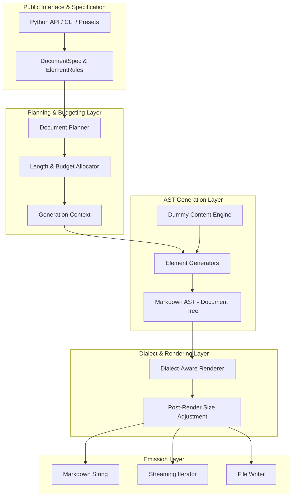
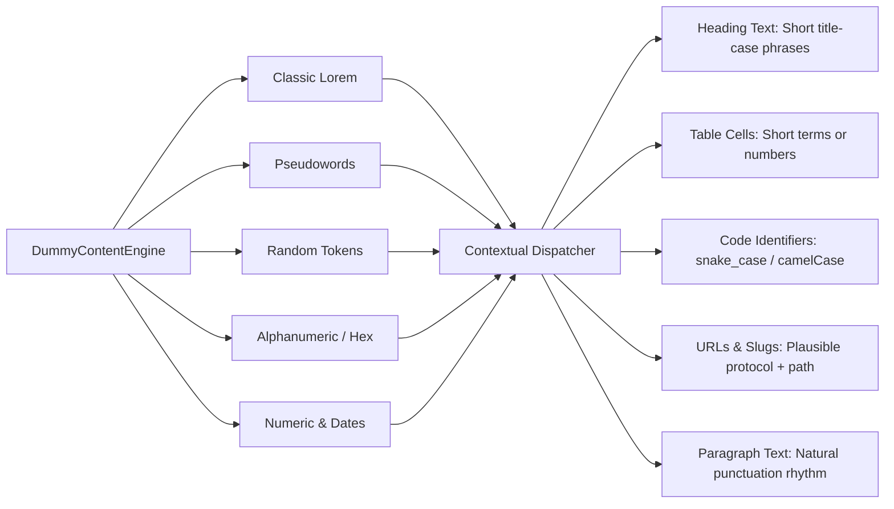
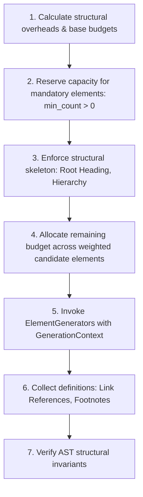
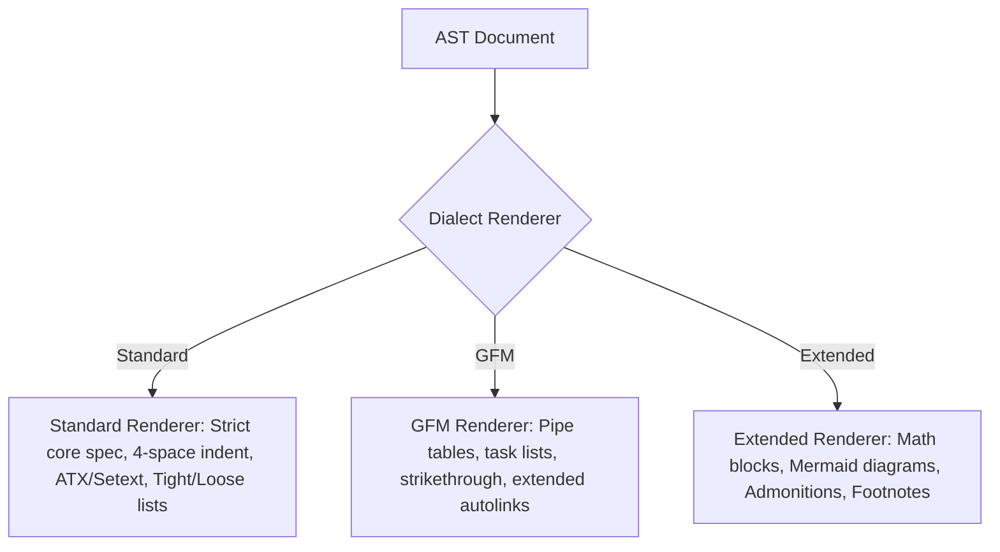

# `dummy-md` — Architecture Specification

> **Goal:** Build a robust, extensible Python library that generates arbitrary amounts of syntactically valid Markdown containing configurable combinations of Markdown elements, filled with meaningless placeholder content.

---

## 1. Core Design Principles

`dummy-md` is designed around six foundational principles:

1. **Element Control:** Enable, disable, weight, or specify exact counts and hierarchical rules for every supported Markdown element.
2. **Length Control:** Target generation by characters, words, lines, top-level blocks, or approximate encoded byte size, in both approximate (tolerant) and exact modes.
3. **Valid Markdown by Construction:** Produce structures that parse and render cleanly into standard semantic trees across strict specifications, avoiding malformed constructs (e.g., unclosed code fences, broken table rows, invalid link references, or dangling HTML tags).
4. **Reproducibility:** A given configuration together with an explicit random seed always produces bit-identical output across platforms and Python versions.
5. **Extensibility:** Introduce new Markdown syntaxes, dialects, and custom renderers (e.g., Obsidian callouts, MkDocs admonitions) via a clean plugin interface without altering core generator logic.
6. **Scalability:** Scale from inline snippets (single elements) to multi-gigabyte benchmark documents using an incremental generator and chunked streaming iterators without unbounded memory consumption.

---

## 2. High-Level Architecture

The system avoids the fragile pattern of string concatenation. Instead, generation flows through a pipeline of decoupled layers:



### Architectural Axiom: AST-First Generation
**Generators produce typed Abstract Syntax Tree (AST) nodes, never raw Markdown strings.**

Handling syntax generation at the AST level resolves fundamental structural challenges:
- Automatic escaping of Markdown punctuation in inline text (asterisks, underscores, brackets, pipes, backticks, ampersands).
- Precise list nesting, bullet/number delimiter styles, tight versus loose spacing, and indentation alignment.
- Code fence delimiter escalation (e.g., nesting ```` ``` ```` inside ```` ```` ````).
- Link reference definitions (full, collapsed, and shortcut references) and footnote identifier tracking.
- Decoupling content semantics from dialect-specific syntax (e.g., Setext vs. ATX headings, indented vs. fenced code, pipe tables vs. fallback blocks).

---

## 3. Markdown AST (Document Tree)

The AST acts as the canonical intermediary representation between generation rules and dialect emission.

### Node Classification

Nodes are organized into two primary categories:

1. **Block Nodes:** Structural elements separated by blank lines or standard block delimiters.
2. **Inline Nodes:** Flow content residing exclusively within specific block nodes (e.g., within paragraphs, table cells, list item content, or blockquotes).

```mermaid
classDiagram
    class MarkdownNode {
        <<abstract>>
        +accept(visitor)
    }
    class BlockNode {
        <<abstract>>
    }
    class InlineNode {
        <<abstract>>
    }
    class Document {
        +list[BlockNode] children
        +dict[str, LinkDefinition] link_definitions
        +dict[str, BlockNode] footnote_definitions
    }
    class Heading {
        +int level
        +list[InlineNode] children
        +str style
    }
    class Paragraph {
        +list[InlineNode] children
    }
    class ThematicBreak {
        +str character
    }
    class IndentedCodeBlock {
        +str code
    }
    class FencedCodeBlock {
        +str code
        +str language
        +str fence_char
        +int fence_length
    }
    class HTMLBlock {
        +int block_type
        +str content
    }
    class LinkDefinition {
        +str label
        +str destination
        +str title
        +str title_delimiter
    }
    class ListBlock {
        +bool ordered
        +str delimiter
        +int start
        +bool tight
        +list[ListItem] items
    }
    class ListItem {
        +list[BlockNode] children
        +bool? checked
    }
    class Blockquote {
        +list[BlockNode] children
    }
    class Table {
        +list[str] headers
        +list[list[list[InlineNode]]] rows
        +list[str] alignments
    }
    class Text {
        +str content
    }
    class Escape {
        +str character
    }
    class CharacterReference {
        +str entity_or_code
        +str kind
    }
    class Emphasis {
        +list[InlineNode] children
        +str delimiter
        +int level
    }
    class CodeSpan {
        +str code
    }
    class Link {
        +list[InlineNode] text
        +str destination
        +str title
        +str kind
        +str label
    }
    class Image {
        +str alt
        +str destination
        +str title
        +str kind
        +str label
    }
    class Autolink {
        +str target
        +bool is_email
    }
    class RawHTML {
        +str content
    }
    class LineBreak {
        +bool hard
        +str style
    }

    MarkdownNode <|-- BlockNode
    MarkdownNode <|-- InlineNode
    BlockNode <|-- Document
    BlockNode <|-- Heading
    BlockNode <|-- Paragraph
    BlockNode <|-- ThematicBreak
    BlockNode <|-- IndentedCodeBlock
    BlockNode <|-- FencedCodeBlock
    BlockNode <|-- HTMLBlock
    BlockNode <|-- ListBlock
    BlockNode <|-- ListItem
    BlockNode <|-- Blockquote
    BlockNode <|-- Table
    InlineNode <|-- Text
    InlineNode <|-- Escape
    InlineNode <|-- CharacterReference
    InlineNode <|-- Emphasis
    InlineNode <|-- CodeSpan
    InlineNode <|-- Link
    InlineNode <|-- Image
    InlineNode <|-- Autolink
    InlineNode <|-- RawHTML
    InlineNode <|-- LineBreak
```



### Structural Invariants
- `Document` contains only `BlockNode` instances.
- `Table` cells contain only `InlineNode` sequences; block-level nodes in table cells are disallowed.
- Nesting depth is explicitly constrained by `max_nesting_depth` to prevent recursion blowouts.
- All reference definitions (`[label]: destination 'title'`) are registered on the `Document` context to ensure 100% referential integrity.
- List tight/loose flags cleanly govern whether child items render wrapped in paragraph blank lines or compact spacing.

---

## 4. Comprehensive Feature Catalog & Element Registry

`dummy-md` supports the entire inventory of standard Markdown elements together with dialect-specific extensions.

### Complete Element Catalog

| Family | Element | Syntax Variants | Dialect Support |
| :--- | :--- | :--- | :--- |
| **Thematic Breaks** | Horizontal Rule | `***`, `---`, `___` (with variable spacing) | Standard, GFM |
| **Headings** | ATX Headings | `#` through `######` (optional closing `#` sequence) | Standard, GFM |
| | Setext Headings | Level 1 (`===`), Level 2 (`---`), multiline heading text | Standard, GFM |
| **Paragraphs & Breaks** | Paragraphs | Non-blank text lines with soft breaks | Standard, GFM |
| | Hard Line Breaks | Trailing two spaces (`  \n`) or trailing backslash (`\\\n`) | Standard, GFM |
| | Soft Line Breaks | Standard line break (`\n`) within paragraphs | Standard, GFM |
| | Blank Lines | Boundary separators between blocks | Standard, GFM |
| **Escapes & References** | Backslash Escapes | All 12 ASCII punctuation characters: `\!`, `\"`, `\#`, `\$`, `\%`, `\&`, `\'`, `\(`, `\)`, `\*`, `\+`, `\,`, `\-`, `\.`, `\/`, `\:`, `\;`, `\<`, `\=`, `\>`, `\?`, `\@`, `\[`, `\\`, `\]`, `\^`, `\_`, `\``, `\{`, `\|`, `\}`, `\~` | Standard, GFM |
| | Entity References | Named entities (`&amp;`, `&lt;`, `&gt;`, `&copy;`, `&euro;`) | Standard, GFM |
| | Numeric References | Decimal (`&#38;`) and hexadecimal (`&#x26;`) references | Standard, GFM |
| **Inline Formatting** | Emphasis | Single delimiter: `*italic*` and `_italic_` | Standard, GFM |
| | Strong Emphasis | Double delimiter: `**bold**` and `__bold__` | Standard, GFM |
| | Bold + Italic | Triple delimiter: `***bold italic***` and `___bold italic___` | Standard, GFM |
| | Strikethrough | Double tilde: `~~deleted~~` | GFM, Extended |
| | Code Spans | Single/multi backticks (`` `code` ``, ```` `` `foo` `` ````) | Standard, GFM |
| **Code Blocks** | Indented Code | 4 spaces or tab indentation, preserving blank lines | Standard, GFM |
| | Fenced Code | ```` ``` ```` or `~~~`, customizable info strings & adaptive length | Standard, GFM |
| **Lists** | Unordered Lists | Bullet markers `-`, `+`, `*` | Standard, GFM |
| | Ordered Lists | Delimiters `.` and `)` (e.g. `1.`, `1)`), custom start numbers | Standard, GFM |
| | Tight & Loose | Tight lists (compact) vs. loose lists (blank line separation) | Standard, GFM |
| | Nested Lists | Multi-level sublists with required block indentation | Standard, GFM |
| | Task Lists | Items with checkbox markers: `- [ ]`, `- [x]` | GFM, Extended |
| **Links** | Inline Links | `[text](destination)` and `[text](destination "title")` | Standard, GFM |
| | Angle Bracket URLs | `[text](<destination with spaces> "title")` | Standard, GFM |
| | Full Reference Links | `[text][label]` with separate link definition | Standard, GFM |
| | Collapsed References | `[label][]` referencing matching label definition | Standard, GFM |
| | Shortcut References | `[label]` referencing matching label definition | Standard, GFM |
| | Autolinks | URI autolinks (`<https://example.com>`) and Email (`<user@test.org>`) | Standard, GFM |
| | Extended Autolinks | Bare URLs (`https://example.com`, `www.example.com`, `user@test.org`) | GFM |
| **Images** | Inline Images | `` and `` | Standard, GFM |
| | Reference Images | Full `![alt][label]`, collapsed `![label][]`, shortcut `![label]` | Standard, GFM |
| **Link Definitions** | Reference Defs | `[label]: destination "title"`, `'title'`, or `(title)` | Standard, GFM |
| **Blockquotes** | Blockquotes | `>` prefix, nested blockquotes (`>>`), lazy continuations | Standard, GFM |
| **HTML Blocks** | HTML Block 1 | `<script>`, `<pre>`, `<style>` blocks | Standard, GFM |
| | HTML Block 2 | HTML comments (`<!-- comment -->`) | Standard, GFM |
| | HTML Block 3 | Processing instructions (`<?php ... ?>`) | Standard, GFM |
| | HTML Block 4 | Declarations (`<!DOCTYPE html>`, `<!ENTITY ...>`) | Standard, GFM |
| | HTML Block 5 | CDATA sections (`<![CDATA[ ... ]]>`) | Standard, GFM |
| | HTML Block 6 | Standard block tags (`<div>`, `<p>`, `<table>`, `<section>`, etc.) | Standard, GFM |
| | HTML Block 7 | Generic complete open/close tags | Standard, GFM |
| **Raw Inline HTML** | Inline HTML | Open tags (`<span>`), close tags (`</span>`), comments, self-closing | Standard, GFM |
| | Disclosure Accordion | `<details>` and `<summary>` blocks | GFM, Extended |
| **Tables** | Pipe Tables | Headers, alignment colons (`:---`, `:---:`, `---:`), rows | GFM, Extended |
| **Extensions** | Footnotes | Inline marker `[^note]` and definition `[^note]: explanation` | Extended |
| | Math | Inline math (`$E=mc^2$`) and display math blocks (`$$...$$`) | Extended |
| | Mermaid | Fenced diagram code blocks (`graph TD`, `sequenceDiagram`) | Extended |
| | Admonitions | Callout quotes (`> [!NOTE]`, `> [!TIP]`, `> [!WARNING]`) | Extended |
| | Front Matter | YAML metadata (`---`) or TOML metadata (`+++`) header | Extended |

---

## 5. Granular Element Options

Each element provides an isolated, typed options model allowing targeted configuration:

```python
from dataclasses import dataclass, field
from typing import Literal

@dataclass(frozen=True)
class HeadingOptions:
    levels: list[int] = field(default_factory=lambda: [1, 2, 3, 4])
    style: Literal["atx", "setext", "random"] = "atx"
    closed_atx: bool = False
    hierarchical: bool = True

@dataclass(frozen=True)
class ListOptions:
    types: list[Literal["unordered", "ordered", "task"]] = field(
        default_factory=lambda: ["unordered", "ordered"]
    )
    bullet_markers: list[Literal["-", "*", "+"]] = field(
        default_factory=lambda: ["-", "*"]
    )
    ordered_delimiters: list[Literal[".", ")"]] = field(
        default_factory=lambda: ["."]
    )
    tight: bool | None = None  # None for random mix
    start_number: int = 1
    min_items: int = 2
    max_items: int = 8
    max_depth: int = 3

@dataclass(frozen=True)
class CodeBlockOptions:
    style: Literal["fenced", "indented", "random"] = "fenced"
    fence_char: Literal["`", "~"] = "`"
    languages: list[str] = field(
        default_factory=lambda: ["python", "javascript", "bash", "json", "markdown"]
    )
    min_lines: int = 2
    max_lines: int = 15

@dataclass(frozen=True)
class TableOptions:
    min_rows: int = 2
    max_rows: int = 8
    min_columns: int = 2
    max_columns: int = 6
    alignment: Literal["left", "right", "center", "random", "none"] = "random"
    inline_formatting: bool = True

@dataclass(frozen=True)
class LinkOptions:
    styles: list[Literal["inline", "reference", "collapsed", "shortcut", "autolink"]] = field(
        default_factory=lambda: ["inline", "reference", "autolink"]
    )
    title_probability: float = 0.3
    allow_email_autolinks: bool = True

@dataclass(frozen=True)
class HTMLOptions:
    allowed_types: list[int] = field(default_factory=lambda: [1, 2, 6, 7])
    allow_inline: bool = True
    allow_details: bool = True
```

---

## 6. Dummy Content Engine

Content generation is decoupled from syntax generation. The `DummyContentEngine` provides context-specific placeholder material rather than indiscriminate paragraph slicing.



### Text Generation Strategies

1. **Classic Lorem:** Traditional Latin text (`Lorem ipsum dolor sit amet...`) for familiar document layouts.
2. **Pseudowords:** Pronounceable, grammatically cadence-matched artificial words (`pelatum serivo navori...`) avoiding Latin fatigue.
3. **Random Tokens:** Arbitrary ASCII letter clusters (`xvqpm nzkta qlwre`) for parser stress testing.
4. **Alphanumeric:** Mixed token streams (`ax19 bz04 tx82`) useful for technical logs, serials, and IDs.
5. **Numeric:** Pure integers, floats, currency, and dates for tabular data simulation.

### Contextual Dispatching Methods
- `text_engine.sentence(min_words=5, max_words=15)`
- `text_engine.paragraph(sentences=4)`
- `text_engine.heading_phrase(level=2)`
- `text_engine.table_cell(numeric_ratio=0.3)`
- `text_engine.identifier(style="snake_case")`
- `text_engine.url(secure=True)`
- `text_engine.email()`
- `text_engine.code_snippet(language="python", lines=5)`

---

## 7. Document Planner & Generation Context

The **Document Planner** converts user requirements into a sequence of generation steps using a **constraint-first, weighted-random-second** approach.

### Generation Sequence



### Generation Context State
A single `GenerationContext` is threaded through all generators:
- **`rng: random.Random`:** Dedicated seeded instance ensuring strict determinism without side effects on global random state.
- **`dialect: DialectSpec`:** Current dialect capability flags (supports tables, task lists, strikethrough, etc.).
- **`text_engine: DummyContentEngine`:** Configured text generator.
- **`budget: BudgetTracker`:** Running ledger of consumed vs. remaining length metrics.
- **`current_depth: int`:** Nesting depth tracker for lists, blockquotes, and container nodes.
- **`heading_state: HeadingTracker`:** Enforces logical hierarchy progression (e.g., prevent jumping from H1 directly to H4).
- **`reference_pool: ReferenceRegistry`:** Tracks allocated reference IDs (`ref-1`, `ref-2`) and footnote anchors.

---

## 8. Length Management & Budgeting Engine

Controlling the output length of structured markup is non-trivial: a table or a nested list has fixed syntax overhead that cannot simply be sliced at character $N$ without corrupting the document.

### Supported Measurement Units

| Unit | Measurement Target |
| :--- | :--- |
| `chars` | Total character count of serialized Markdown output |
| `words` | Total count of readable text words (excluding syntax marks) |
| `lines` | Total newline-delimited output lines |
| `blocks` | Total number of top-level AST block nodes |
| `bytes` | UTF-8 encoded byte size of the final output |

### Generation Modes

1. **Approximate Mode (Default):** Targets the specified length within a configurable tolerance (e.g., `±5%`), prioritizing document diversity, variety of structures, and realistic section layouts.
2. **Exact Mode:** Guarantees exact match for the target metric where feasible. If constraints conflict (e.g., asking for 50 characters while requiring 3 tables), the engine raises an explicit `BudgetError` detailing the minimal structural floor.

### Length Adjustment Algorithm
To achieve precise character and byte constraints:
1. Generate structural elements (headings, tables, code blocks, lists) with reasonable baseline content.
2. Designate a subset of nodes as **elastic** (typically body paragraphs and list item descriptions).
3. Serialize the tentative AST to measure the delta between actual and target length.
4. Expand or shrink elastic text content by appending or trimming sentences/words at token boundaries.
5. Apply final fine-grained filler adjustments inside paragraphs before rendering.

---

## 9. Dialect-Aware Renderers

Renderers serialize the AST into compliant Markdown text according to the target dialect specification.



### Renderer Responsibilities
- **Markdown Delimiter Escaping:** Ensure text containing `*`, `_`, `[`, `]`, `` ` ``, `<`, `|`, `&` does not trigger unintended parsing.
- **Adaptive Code Delimiters:** If code content contains 3 consecutive backticks, render with 4 backticks (or tildes).
- **Whitespace & Boundary Normalization:** Insert correct blank-line separation between blocks as required by strict specification rules.
- **List Indentation Alignment:** Compute correct prefix widths (e.g., `1.  ` vs `10. `) so nested blocks align to indentation requirements.
- **Table Pipe Padding & Escaping:** Escape literal pipe characters (`\|`) inside table cells and format alignment separator colons (`:---`, `:---:`, `---:`).
- **Footnote & Reference Appending:** Render collected reference link definitions and footnote bodies at the bottom of the document cleanly.

---

## 10. Plugin Architecture & Extensibility

Users and third-party packages can extend `dummy-md` without modifying core source code via Python Protocols and standard entry points.

### Extension Protocols

```python
from typing import Protocol, runtime_checkable

@runtime_checkable
class ElementGenerator(Protocol):
    name: str
    supported_dialects: set[str]

    def generate(
        self,
        context: "GenerationContext",
        options: object,
    ) -> "MarkdownNode":
        ...

@runtime_checkable
class NodeRenderer(Protocol):
    node_type: type["MarkdownNode"]

    def render(
        self,
        node: "MarkdownNode",
        renderer: "BaseRenderer",
    ) -> str:
        ...
```

### Registry Operations
The central `ElementRegistry` allows dynamic addition of new elements and renderers:

```python
from dummy_md.core.registry import registry

registry.register_element(name="mermaid", generator=MermaidGenerator())
registry.register_renderer(dialect="gfm", node_type=MermaidNode, renderer=MermaidRenderer())
```

Third-party packages expose plugins using standard packaging entry points under the `dummy_md.elements` and `dummy_md.dialects` groups in `pyproject.toml`.

---

## 11. Public API Design

`dummy-md` offers a dual-layer API: an intuitive functional interface for rapid scripting, and an expressive object-oriented interface for programmatic control.

### Simple API

```python
import dummy_md

# Generate a GFM string of approximately 5000 characters
markdown = dummy_md.generate(
    length=5000,
    unit="chars",
    dialect="gfm",
    elements=["heading", "paragraph", "table", "list", "code"],
    seed=42,
)

# Stream chunks directly
for chunk in dummy_md.iter_chunks(length=50000, unit="words", seed=100):
    process(chunk)
```

### Advanced API

```python
from dummy_md import Generator, DocumentSpec, ElementRule, LengthSpec
from dummy_md.elements import TableOptions, HeadingOptions

spec = DocumentSpec(
    dialect="gfm",
    seed=42,
    length=LengthSpec(
        value=15000,
        unit="chars",
        mode="approximate",
        tolerance=0.03,
    ),
    elements={
        "heading": ElementRule(
            min_count=4, 
            max_count=10, 
            weight=3, 
            options=HeadingOptions(levels=[1, 2, 3], style="atx")
        ),
        "paragraph": ElementRule(weight=10),
        "table": ElementRule(
            min_count=2, 
            weight=4, 
            options=TableOptions(min_rows=4, max_rows=8, min_columns=3, max_columns=5)
        ),
        "code_block": ElementRule(weight=3),
        "task_list": ElementRule(weight=2),
        "blockquote": ElementRule(weight=2),
    },
    text_style="pseudowords",
    max_nesting_depth=3,
)

generator = Generator(spec)
md_text = generator.generate()
generator.write("benchmark_fixture.md")
```

### Method Summary

| Method | Return Type | Description |
| :--- | :--- | :--- |
| `dummy_md.generate(...)` | `str` | High-level generator returning Markdown string. |
| `dummy_md.iter_chunks(...)` | `Iterator[str]` | Memory-efficient streaming generator. |
| `dummy_md.write(path, ...)` | `Path` | Generates and writes directly to target filesystem path. |
| `Generator.generate()` | `str` | Executes full planning and returns serialized output. |
| `Generator.to_ast()` | `Document` | Returns the raw AST document tree for inspection. |
| `Generator.iter_chunks(chunk_size)` | `Iterator[str]` | Streams sections sequentially. |
| `dummy_md.available_elements()` | `list[str]` | Returns list of registered element identifiers. |
| `dummy_md.available_presets()` | `dict[str, str]` | Returns dictionary of registered preset names and descriptions. |
| `dummy_md.validate(markdown)` | `ValidationReport` | Parses and verifies structural validity of generated Markdown. |

---

## 12. Command Line Interface (CLI)

The CLI mirrors the Python API, providing instant access for developers generating test fixtures, benchmark corpora, and demo files.

```bash
# Generate basic GFM text
dummy-md generate --chars 10000 --dialect gfm

# Generate standard compliant text
dummy-md generate --chars 8000 --dialect standard

# Use a pre-configured preset
dummy-md generate --preset tables --words 2500 --output test_tables.md

# Deterministic fixture generation
dummy-md generate --seed 1337 --blocks 50 --output fixture.md

# Large-scale stress test (streamed directly to disk)
dummy-md generate --size 50MB --output stress_test.md

# Inspect registered capabilities
dummy-md elements
dummy-md presets
```

---

## 13. Testing & Verification Strategy

Correctness is validated across three distinct tiers:

1. **Structural AST Verification:**
   - Invariant testing for AST nodes (e.g., no blocks in table cells, valid heading hierarchy, non-negative depths).
   - Determinism verification: Verify identical seed produces identical AST hashes.
2. **Parser Round-Trip Testing:**
   - Serialized Markdown is parsed using standard compliant parsers (e.g., `markdown-it-py`).
   - Structural comparison: Assert that tables parse as table tokens, lists parse as list tokens, code blocks retain uncorrupted delimiters, and escapes/entities decode faithfully.
3. **Property-Based Testing (Hypothesis):**
   - Fuzz arbitrary combinations of element weights, target lengths, and random seeds.
   - Assert: No unhandled exceptions, generated length conforms to specified tolerances, and output parses without syntax errors.

---

## 14. Summary of Locked Architectural Decisions

| Area | Decision | Rationale |
| :--- | :--- | :--- |
| **Internal Representation** | Typed AST Dataclasses | Prevents delimiter collision, guarantees correct nesting, decouples dialect emission. |
| **Randomness Source** | Isolated `random.Random(seed)` | Zero side effects on global Python RNG; ensures cross-run reproducibility. |
| **Element Selection** | Constraint-first, weighted-second | Guarantees required elements appear before filling remaining budget. |
| **Length Calculation** | Serialized measurement + elastic filler | Avoids slicing through structural markup which causes syntax breakage. |
| **Default Dialect** | GitHub Flavored Markdown (GFM) | De facto standard for READMEs, issues, documentation, and modern tooling. |
| **Default Text Engine** | Pseudowords | Readable, realistic text rhythm without Latin monotony or parser interference. |
| **Dependencies** | Standard library core | Zero required runtime dependencies; validation parsers are optional dev/test extras. |
| **Streaming Design** | Sectional AST generation | Enables generating multi-hundred-megabyte files with constant memory footprint. |
