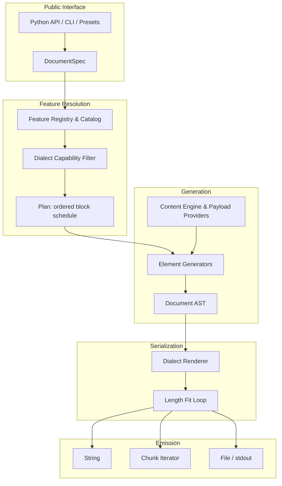
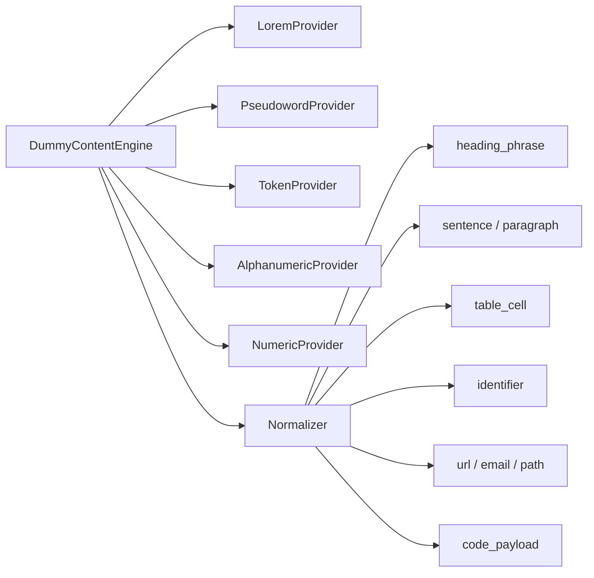
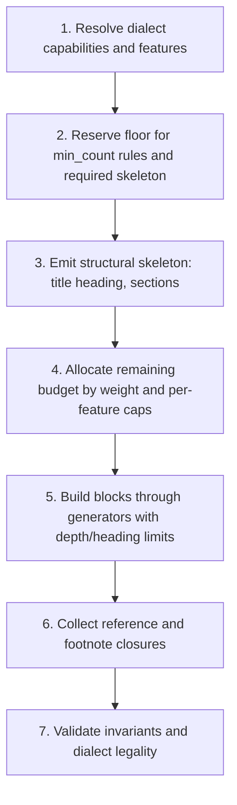

# `dummy-md` — Architecture Specification

> **Goal:** Build a robust, extensible Python library that generates arbitrary amounts of
> syntactically valid Markdown as configurable combinations of Markdown features, filled with
> meaningless placeholder content.

This document is the authoritative design specification. Implementation status lives in
[`work-plan.md`](work-plan.md); the machine-readable feature catalog lives in
`src/dummy_md/core/catalog.py`.

---

## 1. Scope

The Markdown ecosystem is not one language. It is a small standardized core (CommonMark), a
widely deployed superset (GFM), and a long tail of dialects (Pandoc, MyST, MkDocs, Quarto,
Obsidian, GitLab, MDX) that disagree about syntax and semantics.

`dummy-md` therefore treats Markdown as a **family of dialects with a shared structural core**:

- A single AST and rendering pipeline.
- Dialect capability sets that decide which nodes and syntax variants are legal.
- A feature registry that addresses individual generation targets (`table.pipe`,
  `table.grid.rowspan`) rather than whole element families.

The library is a **generator**, not a parser, renderer, or validator. It produces placeholder
Markdown; it does not claim to implement every consuming application's quirks.

### 1.1 Non-goals

- No runtime dependency on a Markdown parser. Parsers are test-only verification tools.
- No normalization or rewriting of user-supplied Markdown.
- No sanitization of emitted HTML. Raw HTML is emitted verbatim, by design, as a fixture.
- No guarantee that a dialect's third-party renderer looks like the specification.

---

## 2. Design Principles

1. **AST-first construction.** Generators return typed `MarkdownNode` instances. Only renderers
   emit characters. Delimiter escaping, fence escalation, list indentation, pipe padding, and
   blank-line separation are renderer responsibilities, never generator responsibilities.
2. **Valid within the selected dialect.** A document must parse cleanly under the dialect that
   produced it. Anything the dialect cannot express is rejected at planning time
   (`DialectError`), not silently degraded into a different feature.
3. **Strict determinism.** Every random decision uses `context.rng` (a seeded `random.Random`).
   Ordering is explicit (insertion or `sorted()`); no `hash()`, no set iteration, no wall-clock
   time, no `os.environ` reads. Same `DocumentSpec` → byte-identical output on every platform
   and Python version.
4. **Length control without slicing.** Length is satisfied by expanding or contracting
   *elastic* text nodes, then re-measuring serialized output. Raw Markdown is never sliced.
5. **Feature-level control.** Users enable, disable, weight, or count individual features and
   glob-selected families (`heading.*`, `table.*`, `math.*`) within dialect limits.
6. **Composition over enumeration.** A feature is data — a `FeatureSpec` — not a class. Families
   share a generator; variants are options; payloads (code snippets, math, diagrams, metadata)
   are provided by data providers.
7. **Extensibility without forks.** Third parties register generators, renderers, and dialects
   through a registry and standard entry points.
8. **Zero runtime dependencies.** The core imports only the standard library. `pytest`,
   `hypothesis`, `markdown-it-py`, `ruff`, and `mypy` are development extras.

---

## 3. Architecture Overview



The fit loop serializes the AST, measures the requested unit, and mutates elastic nodes until
the target is met. It never slices rendered output.

---

## 4. Feature Model

A **feature** is one addressable generation target. Features are grouped into families and
classified by kind, tier, and dialect support. Nineteen families have generators: the original
block and inline families plus `citation`, `directive`, `platform` and `mdx`. The `stress`
fixtures are emitted through the paragraph, code, list and link generators; only
`stress.document.large` remains a catalogued test variation rather than a syntax element.

### 4.1 Compatibility legend

| Tag | Meaning |
| :-- | :-- |
| `C` | CommonMark core |
| `G` | GFM specification |
| `E` | Markdown extension or dialect |
| `P` | Platform-specific Markdown |
| `H` | HTML embedded in Markdown |
| `X` | MDX / component Markdown |
| `T` | Test variation or configuration, not distinct syntax |

`C` and `G` are dialects the library renders natively. `E`, `P`, `H`, and `X` are only
emitted inside dialects that declare them (see §5); `T` targets are produced as variations of
an owning feature.

### 4.2 Feature kinds

| Kind | Meaning | Example |
| :-- | :-- | :-- |
| `structure` | A block or inline construct in the AST | `heading.atx`, `list.ordered` |
| `syntax_variant` | Same structure, different serialization | `heading.setext`, `code.fenced.tilde` |
| `payload` | Placeholder content for a construct | `code.payload.python`, `math.latex.cases` |
| `metadata` | Front-matter field or document property | `frontmatter.yaml`, `meta.tags` |
| `stress` | Boundary/robustness fixture | `stress.escape.pipe`, `stress.unicode.cjk` |

Kinds matter because they imply different plumbing: `structure` and `syntax_variant` features
need AST nodes and renderer support; `payload` and `metadata` features are data providers;
`stress` features are toggles applied by generators and renderers.

### 4.3 Tiers

| Tier | Scope | Priority |
| :-- | :-- | :-- |
| **Core** | CommonMark blocks/inlines and GFM additions | P0 |
| **Extended** | Pandoc-style attributes, footnotes, math, grid tables, criteria | P1 |
| **Platform** | GitHub/GitLab/Obsidian/MyST/MkDocs/Quarto syntax | P2 |
| **Advanced** | MDX/JSX, diagram languages, executable chunks, stress fixtures | P3 |

A tier is a roadmap label, not a runtime concept. Runtime gating is `dialect`.

### 4.4 FeatureSpec

```python
@dataclass(frozen=True, slots=True)
class FeatureSpec:
    id: str  # "table.grid.rowspan"
    family: str  # "table"
    kind: str  # structure | syntax_variant | payload | ...
    dialects: frozenset[str]  # dialects that may emit it
    tier: str  # core | extended | platform | advanced
    generator: str | None = None  # generator id, if it needs one
    renderer: str | None = None  # renderer capability id
    requires: frozenset[str] = frozenset()  # prerequisite feature ids
    default_weight: float = 1.0
    implemented: bool = False  # honest status flag
    options: Mapping[str, object] = MappingProxyType({})
```

Rules:

- `id` is stable, lowercase, dot-delimited: `<family>.<element>[.<variant>]`.
- `family` is the first id segment and always exists as a generator family.
- `requires` is a closed dependency graph: no cycles, no dangling ids (checked by a test).
- `implemented` is the single source of truth for `available_elements()`. Catalog entries that
  are planned but not built are registered with `implemented=False` and cannot be selected.
- The catalog is plain data in `core/catalog.py`, generated by hand from the research inventory;
  a test asserts unique ids, known dialects, known kinds, and resolvable `requires`.

### 4.5 Selection syntax

`include` / `exclude` accept feature ids and `fnmatch`-style globs:

```python
generate(
    length=20000,
    unit="chars",
    dialect="gfm",
    include=["heading.*", "list.*", "table.pipe", "code.*"],
    exclude=["code.payload.sql"],
    seed=42,
)
```

Resolution order:

1. Start from every `implemented` feature of the dialect that is not excluded.
2. If `include` is non-empty, intersect with its expansion (`include` wins over the default set,
   `exclude` still wins over `include`).
3. Expand `requires` transitively (a selected `table.grid.rowspan` pulls in `table.grid`).
4. Group the result by generator family; a family is scheduled only if at least one of its
   features survived.

An unknown or unimplemented id in `include` raises `ConfigurationError` — silent no-ops make
fixtures lie. `exclude` with no match is also an error, for the same reason.

Selection is a capability filter, not a checklist: `include` decides which syntax may appear,
while per-generator option ratios decide how often each variant actually appears. A one-block
document can therefore contain none of a permitted variant; the catalog promises that the
engine *can* emit a feature, and the fidelity tests prove that path exists.

---

### 4.6 Documentation and platform families

- **Citations.** `Citation` carries keys, bracketed/narrative mode, prefix, suffix, locator and
  suppress-author flag. The renderer emits Pandoc citation syntax; bibliography entries are
  `FrontMatter` blocks, which the engine hoists to the document start and merges with the
  front-matter generator's metadata. YAML merges are key-aware: the first value for a key wins
  and duplicate keys from platform metadata are dropped, so generated front matter stays valid.
- **Directives.** `DirectiveBlock` and `DirectiveInline` carry a style (`myst`, `mkdocs`,
  `quarto`), name, argument, title and options. The renderer owns the colon fence, `!!!`/`???`
  admonition header, `=== "Tab"` header or Quarto fenced-div spelling.
- **MDX.** `MdxBlock` and `MdxInline` carry raw ESM/JSX payload; the renderer requires the
  originating feature and emits the payload verbatim. JSX is never generated as Markdown text.
- **Platform syntax.** `Embed`, `Tag`, `InlineComment`, `BlockId`, `PlatformRef` and
  `CodeBlock.meta` cover Obsidian, GitLab and Docusaurus constructs. Platform code-title,
  highlight, line-number and annotation features are expressed through `CodeBlock` fields, not
  raw fenced strings.
- **Grid tables.** `Table(style="grid")` is rendered by a fixed-width layout pass. Row and column
  spans are laid out by occupancy; Pandoc's reader accepts the table but discards span metadata,
  which is recorded as a known limitation rather than hidden. Cell rendering escapes unescaped
  pipes after inline rendering, so link labels inside pipe/grid tables cannot split a row.
- **Stress fixtures.** Paragraph variants emit escape nodes, character references, Unicode
  samples and explicit LF/CRLF line-break nodes. Raw-byte line endings never pass through the
  normal text escaper.

---

## 5. Dialects and Capability Sets

A dialect is a named feature set plus a renderer. Capability sets are declarations, verified by
round-trip tests, not wishes.

| Dialect | Base | Adds | Renderer |
| :-- | :-- | :-- | :-- |
| `commonmark` | CommonMark 0.31 | raw HTML, entities, reference links | `CommonMarkRenderer` |
| `gfm` | `commonmark` | pipe tables, task lists, strikethrough, extended autolinks | `GFMRenderer` |
| `extended` | `gfm` | attributes, footnotes, math, mermaid/diagram fences, callouts, front matter | `GFMRenderer` |
| `stress` | `extended` | same capability set; the `stress` preset adds token text and deeper nesting | `GFMRenderer` |

Dialect capability sets are derived from the catalog: every feature declares the dialects that
may emit it, and a dialect's set is the union of its implemented features. The base chain in the
table above describes intent; the catalog is the source of truth. Generation style (text
provider, nesting depth) is a spec/preset concern, not a dialect one: `dialect` controls what
syntax may appear, `preset` controls how it is mixed.

```python
DialectSpec(
    name="gfm",
    renderer="gfm",
    features=frozenset({"table.pipe", "list.task", "inline.strikethrough", ...}),
)
```

Requesting a feature outside the set raises `DialectError` listing the dialects that do support
it.

### 5.1 HTML is a dialect decision, not an escape hatch

Raw HTML (`html.inline`, `html.block.*`, `html.table`) exists in `commonmark`, because CommonMark
specifies it. It is excluded from `gfm`-only *profiles* when a preset opts out, but not banned by
the dialect. Presets, not dialects, express "README-safe" or "no HTML" policies.

### 5.2 Custom dialects

A registry can derive new dialects from an existing one without touching the catalog:

```python
from dummy_md import Registry
from dummy_md import elements

registry = Registry()
elements.register(registry)
registry.add_dialect(
    "docs", base="gfm", add=["math.display.dollar"], remove=["html.block"]
)
```

Added features must be implemented; removed features must exist in the base. The derived
capability set is authoritative for selection and for the renderer's capability guard, so
`generate(dialect="docs", registry=registry, include=["math.display.dollar"])` works even though
no catalog row mentions `docs`. Renderer names can be overridden per dialect via
`registry.register_renderer(...)`.

### 5.3 Feature weights and pluggable content

Each feature has a `default_weight`; `DocumentSpec.feature_weights` overrides it. Generators
that choose between variants (inline formatting, code payloads, link kinds, callout kinds,
math environments, diagram types, table alignments, list markers, HTML elements) use
`context.weighted_feature(...)`, so weights are the single knob for variant mix.

Beyond syntax, the content layer is pluggable without subclassing the engine:

- `register_text_style(name, provider)` adds a word source; everything above the word level
  (sentences, casing, punctuation) is unchanged, so custom styles keep the same layout
  guarantees.
- `register_preset(Preset(...))` adds a named bundle of include/exclude rules, element rules
  and text style, selectable by `generate(preset=...)`.
- `DocumentSpec.to_json()`, `.from_json()` and `.from_json_file()` make a run reproducible from
  a fixture file; the CLI `spec` and `--spec` commands use the same format.

---

## 6. AST

The AST is the canonical intermediate representation between generation rules and dialect
emission.

### 6.1 Node taxonomy

Nodes are immutable dataclasses (`frozen=True, slots=True`); containers hold tuples, not lists,
so two equal documents compare equal and hash consistently.

```mermaid
classDiagram
    class MarkdownNode {
        <<abstract>>
        +accept(visitor)
    }
    class BlockNode {
        <<abstract>>
    }
    class InlineNode {
        <<abstract>>
    }
    class Document {
        +tuple[BlockNode] children
        +tuple[LinkDefinition] link_definitions
        +tuple[FootnoteDefinition] footnote_definitions
    }
    class Heading {
        +int level
        +tuple[InlineNode] children
        +str style
        +HeadingAttributes attributes
    }
    class Paragraph {
        +tuple[InlineNode] children
    }
    class ThematicBreak {
        +str character
    }
    class CodeBlock {
        +str code
        +str info
        +str fence_char
        +int fence_length
        +bool indented
        +str meta
        +tuple[str] annotations
        +str feature
    }
    class HTMLBlock {
        +int block_type
        +str content
    }
    class ListBlock {
        +bool ordered
        +bool tight
        +str delimiter
        +str style
        +int start
        +tuple[ListItem] items
    }
    class ListItem {
        +tuple[BlockNode] children
        +bool checked
    }
    class Blockquote {
        +tuple[BlockNode] children
        +bool lazy
    }
    class FencedDiv {
        +tuple[BlockNode] children
        +str info
        +Attributes attributes
    }
    class DirectiveBlock {
        +str feature
        +str style
        +str name
        +str argument
        +str title
        +tuple[tuple[str, str]] options
        +tuple[BlockNode] children
    }
    class MdxBlock {
        +str feature
        +str code
    }
    class Bibliography {
        +str feature
        +str kind
        +str content
    }
    class LineBlock {
        +tuple[tuple[InlineNode]] lines
    }
    class DefinitionList {
        +tuple[DefinitionItem] items
    }
    class DefinitionItem {
        +tuple[InlineNode] term
        +tuple[tuple[BlockNode]] definitions
    }
    class AbbreviationDefinition {
        +str label
        +str title
    }
    class MathMacros {
        +tuple[tuple[str, str]] definitions
    }
    class Callout {
        +str kind
        +str title
        +bool foldable
        +bool collapsed
        +tuple[BlockNode] children
    }
    class Table {
        +tuple[TableCell] header
        +tuple[tuple[TableCell]] rows
        +tuple[str] alignments
        +bool outer_pipes
        +str caption
        +str style
    }
    class TableCell {
        +tuple[InlineNode] children
        +int colspan
        +int rowspan
    }
    class Text {
        +str content
    }
    class Escape {
        +str character
    }
    class CharacterReference {
        +str value
        +str kind
    }
    class Emphasis {
        +tuple[InlineNode] children
        +str delimiter
        +int level
    }
    class Strikethrough {
        +tuple[InlineNode] children
    }
    class CodeSpan {
        +str code
    }
    class Link {
        +tuple[InlineNode] children
        +str destination
        +str title
        +str kind
        +str label
    }
    class Image {
        +tuple[InlineNode] alt
        +str destination
        +str title
        +str kind
        +str label
        +int width
        +int height
    }
    class Autolink {
        +str target
        +bool is_email
    }
    class RawHTML {
        +str content
    }
    class LineBreak {
        +bool hard
        +str style
    }
    class FootnoteReference {
        +str label
    }
    class Math {
        +str expression
        +str delimiter
    }
    class CrossRef {
        +str target
        +str kind
    }
    class DirectiveInline {
        +str feature
        +str style
        +str name
        +str argument
    }
    class MdxInline {
        +str feature
        +str code
    }
    class Embed {
        +str feature
        +str target
        +str fragment
        +int width
        +int height
    }
    class Tag {
        +str feature
        +str name
    }
    class InlineComment {
        +str feature
        +str text
    }
    class BlockId {
        +str feature
        +str name
    }
    class PlatformRef {
        +str feature
        +str kind
        +str value
    }
    class Citation {
        +str feature
        +tuple[str] keys
        +str mode
        +str prefix
        +str suffix
        +str locator
        +bool suppress_author
    }
    class StyledSpan {
        +tuple[InlineNode] children
        +str syntax
    }
    class Critic {
        +tuple[InlineNode] children
        +str kind
        +tuple[InlineNode] replacement
    }
    class EmojiShortcode {
        +str name
    }
    class WikiLink {
        +str target
        +str alias
        +str heading
        +str block
    }
    class Span {
        +tuple[InlineNode] children
        +Attributes attributes
    }
    class InlineFootnote {
        +tuple[InlineNode] children
    }
    class MathBlock {
        +str expression
        +str delimiter
        +str environment
    }
    class Figure {
        +Image image
        +str caption
        +str label
        +bool implicit
    }

    MarkdownNode <|-- BlockNode
    MarkdownNode <|-- InlineNode
    BlockNode <|-- Document
    BlockNode <|-- Heading
    BlockNode <|-- Paragraph
    BlockNode <|-- ThematicBreak
    BlockNode <|-- CodeBlock
    BlockNode <|-- HTMLBlock
    BlockNode <|-- ListBlock
    BlockNode <|-- ListItem
    BlockNode <|-- Blockquote
    BlockNode <|-- Callout
    BlockNode <|-- Table
    BlockNode <|-- MathBlock
    BlockNode <|-- Figure
    InlineNode <|-- Text
    InlineNode <|-- Escape
    InlineNode <|-- CharacterReference
    InlineNode <|-- Emphasis
    InlineNode <|-- Strikethrough
    InlineNode <|-- CodeSpan
    InlineNode <|-- InlineFootnote
    InlineNode <|-- StyledSpan
    InlineNode <|-- Critic
    InlineNode <|-- EmojiShortcode
    InlineNode <|-- WikiLink
    InlineNode <|-- Span
    InlineNode <|-- CrossRef
    InlineNode <|-- Link
    InlineNode <|-- Image
    InlineNode <|-- Autolink
    InlineNode <|-- RawHTML
    InlineNode <|-- LineBreak
    InlineNode <|-- FootnoteReference
    InlineNode <|-- Math
```



### 6.2 Structural invariants

- `Document.children` contains only `BlockNode`; inline nodes at document level are wrapped.
- `Table` cells contain only `InlineNode`. Block content in cells is rejected; grid tables with
  block content require a dedicated `GridTable` node (P1, not the pipe-table node).
- Nesting depth is bounded by `DocumentSpec.max_nesting_depth`; generators receive
  `context.depth` and must refuse to recurse past the bound.
- Reference definitions emitted by a renderer are exactly the set referenced by the AST.
  `Document.link_definitions` and `Document.footnote_definitions` are the closure, produced by
  the engine after generation, and a test asserts 1:1 usage.
- Heading levels follow `HeadingTracker`: no skipped levels relative to the previous heading
  unless `HeadingOptions.allow_skips` is true.
- Immutability: no generator mutates a node it did not create. Elastic resizing is performed by
  the budget layer through explicit `replace()` calls that produce new nodes.

### 6.3 Traversal

`MarkdownNode.accept(visitor)` dispatches on concrete type. Two visitors ship with the core:

- `CountingVisitor` — node counts per type, used by tests and `--stats`.
- `TextVisitor` — concatenated textual content, used to measure `words`.

Traversal is depth-first, children in AST order.

---

## 7. Generators

A generator is a family-level object that produces one block per invocation. It receives the
generation context, its resolved options, and the set of *active features* for that family.

```python
@runtime_checkable
class ElementGenerator(Protocol):
    family: str
    feature_ids: frozenset[str]

    def generate(self, context: GenerationContext) -> BlockNode: ...
```

Rules:

1. `generate` returns exactly one `BlockNode` (lists return the list block, not items).
2. The generator consults `context.active_features` to choose variants; it must never emit a
   variant whose feature id is not active.
3. All randomness comes from `context.rng`; all text from `context.text`.
4. Generators never concatenate Markdown. They build nodes.
5. Generators are cheap to construct and stateless; per-document state lives in the context.

### 7.1 Family → feature mapping

| Generator | Family | Representative features |
| :-- | :-- | :-- |
| `HeadingGenerator` | `heading` | `heading.atx`, `heading.setext`, `heading.attributes` |
| `ParagraphGenerator` | `paragraph` | `paragraph.plain`, `paragraph.hard_break`, `paragraph.soft_break` |
| `BreakGenerator` | `thematic_break` | `thematic_break.hyphen`, `.asterisk`, `.underscore` |
| `ListGenerator` | `list` | `list.unordered`, `list.ordered`, `list.task`, `list.nested` |
| `TableGenerator` | `table` | `table.pipe`, `table.pipe.alignment`, `table.grid` |
| `CodeBlockGenerator` | `code` | `code.fenced`, `code.indented`, `code.payload.*` |
| `QuoteGenerator` | `blockquote` | `blockquote.plain`, `blockquote.nested` |
| `CalloutGenerator` | `callout` | `callout.github.*`, `callout.obsidian.*` |
| `LinkGenerator` | `link` | `link.inline`, `link.reference`, `link.autolink` |
| `ImageGenerator` | `image` | `image.inline`, `image.reference`, `image.figure` |
| `HTMLGenerator` | `html` | `html.block.*`, `html.inline`, `html.details` |
| `FootnoteGenerator` | `footnote` | `footnote.reference`, `footnote.definition` |
| `MathGenerator` | `math` | `math.inline`, `math.display`, `math.latex.*` |
| `DiagramGenerator` | `diagram` | `diagram.mermaid.*`, `diagram.graphviz` |
| `FrontMatterGenerator` | `frontmatter` | `frontmatter.yaml`, `.toml`, `.json` |
| `DirectiveGenerator` | `directive` | `directive.myst.*`, `directive.mkdocs.*` |

Each generator owns an immutable options dataclass in its module (`HeadingOptions`,
`TableOptions`, ...). Options are validated when constructed and may be supplied either as the
dataclass or as a mapping (the form JSON specs use); unknown option keys raise
`ConfigurationError` naming the valid fields.

---

## 8. Content Engine and Payload Providers

Text generation is decoupled from syntax generation. The content engine answers *semantic*
requests ("a heading phrase", "a table cell", "an identifier"), never "a line of Markdown".



### 8.1 Text providers

| Provider | Output | Use |
| :-- | :-- | :-- |
| `lorem` | classic Latin sentences | familiar document texture |
| `pseudowords` | syllable-built artificial words | default; realistic rhythm, no Latin monotony |
| `tokens` | unpronounceable ASCII clusters | parser stress |
| `alphanumeric` | `ax19`, `bz04` style tokens | IDs, serials, log lines |
| `numeric` | integers, floats, currency, dates | tabular data |

All providers implement the same protocol and draw only from `context.rng`. Words are drawn from
deterministic construction rules (syllable tables), not from files or platform data.

### 8.2 Payload providers

Payload features (`code.payload.python`, `math.latex.cases`, `diagram.mermaid.sequence`,
`frontmatter.schema.*`) are served by `PayloadProvider` implementations that return *body text*
for a construct, never delimiters:

```python
@runtime_checkable
class PayloadProvider(Protocol):
    payload_id: str

    def render(
        self, context: GenerationContext, options: Mapping[str, object]
    ) -> str: ...
```

Payload bodies are templates with placeholders filled by the content engine
(`{ident}`, `{number}`, `{token}`), so generated code is syntactically plausible without being
dependent on any parser.

---

## 9. Planner and Generation Context

The planner turns a resolved feature set and a length budget into an ordered schedule of blocks,
using **constraint-first, weighted-random-second** selection.

### 9.1 Plan sequence



Hard constraints, evaluated in order:

1. Every element rule with `min_count > 0` is scheduled.
2. A heading skeleton exists when headings are enabled: exactly one H1 (title) unless
   `HeadingOptions.hierarchical` is false.
3. `max_count` is a hard cap; `min_count <= max_count` is validated up front.
4. Nesting depth never exceeds `max_nesting_depth`.
5. Length floor: if the requested length cannot fit the minimum structural overhead, raise
   `BudgetError` describing the floor.

Soft constraints: weights, per-family variety preference (avoid repeating the same family twice
in a row when alternatives exist), and heading hierarchy progression.

### 9.2 GenerationContext

One context is threaded through the whole run:

| Field | Type | Purpose |
| :-- | :-- | :-- |
| `rng` | `random.Random` | sole randomness source |
| `dialect` | `Dialect` | resolved capabilities and renderer id |
| `text` | `DummyContentEngine` | content provider facade |
| `budget` | `BudgetTracker` | running ledger for the active unit |
| `depth` | `int` | current nesting depth |
| `headings` | `HeadingTracker` | hierarchy state |
| `refs` | `ReferenceRegistry` | link labels, footnote labels, block ids |
| `active_features` | `frozenset[str]` | features legal for the current plan |
| `options` | `Mapping[str, ElementRule]` | per-family rules |

`GenerationContext` is mutable (trackers advance); AST nodes are not.

---

## 10. Length Management

### 10.1 Units

| Unit | Measurement |
| :-- | :-- |
| `chars` | characters of serialized output, excluding the final line terminator (`\n` or `\r\n`) |
| `words` | runs of non-whitespace in textual content (markup excluded) |
| `lines` | newline-separated lines in serialized output |
| `blocks` | top-level block nodes |
| `bytes` | UTF-8 encoded size |

Measurement is performed by the dialect renderer for `chars`/`lines`/`bytes` and by a
`TextVisitor` for `words`/`blocks`, so the two never disagree with what is emitted.

### 10.2 Modes

- **Approximate (default):** within `tolerance` (default `0.05`); diversity and structure are
  preferred over exact trailing filler.
- **Exact:** the fit loop must reach the target exactly or raise `BudgetError` reporting the
  closest achieved value and the operations attempted. Exact mode is guaranteed for `chars` and
  `words`; `lines`, `blocks`, and `bytes` are best-effort and raise when unreachable.

### 10.3 Fit algorithm

1. Generate blocks until the projected budget (structural overhead included) is met.
2. Render and measure.
3. While under target, apply the cheapest elastic operation that fits the remaining delta:
   - append a sentence to the last elastic paragraph;
   - append a word of exactly `delta - 1` characters;
   - append a punctuation mark (1 character);
   - insert a filler block (paragraph or list item).
4. While over target, apply the reverse operations (drop punctuation, drop trailing word, drop
   trailing sentence, drop the last elastic block).
5. Re-render and re-measure until the delta is zero (exact) or within tolerance (approximate).

Elastic nodes are marked at creation (`Paragraph(elastic=True)` is *not* a node field; the
planner records node indices in `context.budget.elastic`). Structural nodes — tables, code
blocks, headings, math — are never resized by the fit loop; their generators receive size hints
instead.

Before fitting, the engine trims whole trailing blocks while the section is over target, never
below a `min_count` floor or a protected structural floor. If the remaining structure alone
exceeds an exact target, `BudgetError` reports the achievable length.

### 10.4 Sections

Serialized units are generated in sections of `SECTION_CHARS` (16 000 characters, overridable
via `chunk_size`). Each section is planned, trimmed, and fitted against its share of the
remaining budget; the last section absorbs the remainder. This bounds the fit loop's working
set and makes `iter_chunks()` a real streaming API rather than a slicing convenience.

---

## 11. Renderers and Escaping

A renderer owns all character-level decisions for one dialect.

```python
class BaseRenderer:
    dialect: Dialect

    def render(self, document: Document) -> str: ...
    def render_block(self, node: BlockNode, depth: int) -> str: ...
    def render_inline(self, node: InlineNode, mode: InlineMode) -> str: ...
```

`InlineMode` (`text`, `table_cell`, `heading`, `link_label`, `image_alt`) selects the escaping
profile. This is the single most important detail in the renderer: the same text node escapes
differently inside a table cell (pipes) than inside a paragraph (no pipes) or a code span (no
escaping at all).

### 11.1 Responsibilities

| Concern | Rule |
| :-- | :-- |
| Escaping | Backslash-escape only characters that would otherwise start markup in the current mode; never double-escape |
| Code fences | Choose a fence longer than the longest run of the fence character inside the body |
| Code spans | Choose a backtick run longer than the longest run inside; pad when content starts/ends with a backtick |
| Lists | Indent continuation blocks by marker width; `1.` vs `10.` changes the gutter |
| Tables | Pad cells to column width; escape `|`; emit alignment colons; `outer_pipes` toggles edge pipes |
| Tight/loose lists | Loose lists separate every item with a blank line; tight lists never do |
| Blockquotes | Prefix every emitted line, including blank lines, with `> ` |
| HTML | Emit verbatim; never re-indent multi-line HTML blocks |
| Front matter | YAML/TOML bodies get `---`/`+++` fences; a JSON body is emitted verbatim and must be a complete object |
| References | Append unused definitions in a stable, sorted order after the body |
| Line endings | `\n` only, always; a single trailing newline terminates the document |

### 11.2 Capability enforcement

`BaseRenderer.render` validates that every block/inline node maps to an active feature of the
dialect. A node with no capability raises `DialectError` naming the node type and dialect. This
is a programming-error guard: the planner should have prevented it, and a test asserts that a
dialect-filtered feature set never produces an unrenderable node.

---

## 12. Extensibility

```python
from dummy_md.core.registry import registry

registry.register_generator(MyGenerator())
registry.register_payload(MyPayloadProvider())
registry.register_dialect(MyDialectSpec())
registry.register_feature(FeatureSpec(...))
```

- Registration is idempotent by id; re-registering an existing id raises `ConfigurationError`
  unless `replace=True`.
- Third-party packages expose plugins via the `dummy_md.elements`, `dummy_md.payloads`, and
  `dummy_md.dialects` entry-point groups. Discovery is explicit
  (`registry.load_entry_points()`), never at import time.
- A plugin can extend an existing family (new feature ids) without changing core modules.

---

## 13. Public API

### 13.1 Functional layer

```python
import dummy_md

md = dummy_md.generate(
    length=5000,
    unit="chars",
    dialect="gfm",
    include=["heading.*", "paragraph.*", "table.pipe", "list.*"],
    seed=42,
)

for chunk in dummy_md.iter_chunks(length=50_000, unit="words", dialect="gfm", seed=100):
    sink.write(chunk)

dummy_md.write("fixture.md", length=10_000, dialect="extended", seed=7)
```

Every functional call accepts the same customization keywords: `text_seed`, `exclude`,
`elements`, `feature_weights`, `text_style`, `max_nesting_depth`, `mode`, `tolerance`,
`preset`, `heading_skeleton`, `include_frontmatter`, `line_ending`, `trailing_newline`,
`section_chars`, `fill_ratio`, and `registry`.

### 13.2 Specification layer

```python
from dummy_md import DocumentSpec, ElementRule, Generator, LengthSpec
from dummy_md.elements import HeadingOptions, TableOptions

spec = DocumentSpec(
    dialect="gfm",
    seed=42,
    length=LengthSpec(value=15_000, unit="chars", mode="approximate", tolerance=0.03),
    include=["heading.*", "paragraph.*", "table.*", "code.*", "list.*"],
    elements={
        "heading": ElementRule(
            min_count=3,
            max_count=10,
            weight=3,
            options=HeadingOptions(levels=(1, 2, 3), style="atx"),
        ),
        "paragraph": ElementRule(weight=10),
        "table": ElementRule(
            min_count=2, weight=4, options=TableOptions(min_rows=4, max_rows=8)
        ),
    },
    text_style="pseudowords",
    max_nesting_depth=3,
)

generator = Generator(spec)
generator.generate()  # str
generator.to_ast()  # Document
generator.write("fixture.md")  # Path
```

### 13.3 Methods

| Method | Returns | Description |
| :-- | :-- | :-- |
| `dummy_md.generate(...)` | `str` | One-shot generation |
| `dummy_md.iter_chunks(...)` | `Iterator[str]` | Streaming generation |
| `dummy_md.write(path, ...)` | `Path` | Generate to file |
| `Generator.generate()` | `str` | Full run |
| `Generator.to_ast()` | `Document` | Inspect the produced tree |
| `Generator.iter_chunks(size)` | `Iterator[str]` | Sectional streaming |
| `dummy_md.available_elements(dialect=None)` | `tuple[str, ...]` | Implemented feature ids |
| `dummy_md.available_dialects()` | `tuple[str, ...]` | Registered dialects |
| `dummy_md.available_presets()` | `Mapping[str, str]` | Name → description |
| `dummy_md.register_text_style(name, provider)` | `None` | Add a word source |
| `dummy_md.text_styles()` | `tuple[str, ...]` | Registered text styles |
| `dummy_md.register_preset(preset)` | `None` | Add a named preset |
| `Registry.add_dialect(name, base=..., add=..., remove=...)` | `Dialect` | Derive a dialect |
| `Registry.register_renderer(name, type)` | `None` | Add a renderer plug-in |
| `DocumentSpec.to_json(path=None)` | `str` | Serialize a run |
| `DocumentSpec.from_json(text)` / `.from_json_file(path)` | `DocumentSpec` | Restore a run |
| `dummy_md.validate(text, dialect)` | `ValidationReport` | Optional parser verification (requires `[dev]` extra) |

---

## 14. CLI

```
dummy-md generate --chars 10000 --dialect gfm --seed 42
dummy-md generate --words 2500 --preset tables -o tables.md
dummy-md generate --blocks 50 --exclude "html.*" --seed 1337
dummy-md generate --bytes 50MB --output stress.md
dummy-md elements [--dialect gfm] [--all]
dummy-md dialects
dummy-md presets
dummy-md validate fixture.md --dialect gfm
```

Behaviour:

- Writes to stdout by default; `--output` writes to a file.
- Exit codes: `0` success, `1` generation/validation failure, `2` usage error.
- Errors go to stderr as `dummy-md: error: <message>` with no traceback unless `--debug`.
- `--size` accepts `KB`/`MB`/`GB` suffixes and maps to the `bytes` unit.

---

## 15. Streaming

`iter_chunks` generates section by section: the planner is asked for the next section budget,
the section is generated and rendered, then discarded. Memory is proportional to the largest
single section, not to the document.

Guarantees:

- Concatenated chunks equal `generate()` for the same spec (tested).
- A chunk boundary never splits a fenced block, table, or list item — sections are cut at
  top-level block boundaries.
- The trailing newline appears exactly once, in the final chunk.

---

## 16. Testing and Verification

| Tier | What it asserts |
| :-- | :-- |
| Unit | AST construction, option validation, escaping, renderer output for each node type |
| Catalog | Unique ids, valid dialects/kinds/tiers, `requires` closure has no cycles or danglers |
| Dialect | Every feature marked `implemented` for a dialect renders and re-parses under that dialect |
| Round-trip | `markdown-it-py` (CommonMark + GFM tables) parse of generated output yields expected token types; code fence content is byte-preserved |
| Determinism | Same spec + seed → identical SHA-256 across processes with different `PYTHONHASHSEED` |
| Property | Hypothesis-driven specs never raise unhandled exceptions; output always parses; lengths respect tolerance |
| Length | Exact mode achieves exact `chars`/`words` or raises `BudgetError`; approximate respects tolerance |
| CLI | Exit codes, stdout/file parity, `elements`/`dialects` output shape |

Tests never assert on placeholder text content beyond structural properties, so text-engine
changes do not produce false failures.

---

## 17. Locked Decisions

| Area | Decision | Rationale |
| :-- | :-- | :-- |
| Representation | Immutable typed AST | Delimiter safety, structural validation, dialect decoupling |
| Feature model | Data (`FeatureSpec`), not classes | 423 catalog targets without 423 classes |
| Randomness | One seeded `random.Random` | Reproducibility, no global side effects |
| Selection | Constraint-first, weighted-second | Mandatory features always appear |
| Length | Measure-and-resize elastic nodes | No broken syntax from slicing |
| Escaping | Renderer-only, mode-aware | Single place to reason about correctness |
| Default dialect | `gfm` | De facto documentation standard |
| Default text | `pseudowords` | Readable, neutral, parser-safe |
| Dependencies | stdlib only at runtime | Install anywhere, no supply chain |
| Streaming | Sectional generation | Constant memory for large fixtures |
| Truthfulness | `implemented` flag + capability guard | The library reports what it can actually emit |