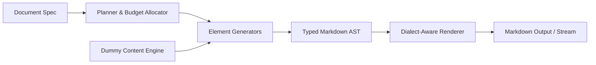

# dummy-md

[](https://www.python.org/downloads/)
[](https://opensource.org/licenses/MIT)
[](https://github.com/astral-sh/ruff)
[](https://mypy.readthedocs.io/)

> **Lorem Ipsum for entire Markdown documents, not just paragraphs.**

`dummy-md` is a Python library that generates arbitrary amounts of syntactically valid, structurally sound Markdown containing configurable combinations of Markdown elements, populated with plausible placeholder content.

Whether you are benchmarking a Markdown renderer, building automated test suites for a static site generator, stress-testing an editor, or preparing sample datasets for LLM evaluation, `dummy-md` delivers deterministic, high-variety Markdown documents on demand.

---

## Key Highlights

- **Syntactically Valid by Design:** Generates a typed Markdown AST before serializing, preventing broken table pipes, unclosed code fences, and malformed list nesting.
- **Accurate Length Budgeting:** Control document length by characters, words, lines, top-level blocks, or approximate file size (`KB`, `MB`).
- **Reproducible & Deterministic:** Given the same configuration and seed, `dummy-md` produces 100% byte-identical output across systems.
- **Dialect-Aware:** Support for standard CommonMark, GitHub Flavored Markdown (GFM), and extended syntax (footnotes, math, Mermaid diagrams, frontmatter).
- **Scalable Streaming:** Stream multi-gigabyte corpora directly to disk or network pipelines with minimal memory overhead.
- **Zero Core Runtime Dependencies:** Written in modern Python standard library with optional developer and parser-testing extensions.

---

## Installation

```bash
pip install dummy-md
```

To install with development and validation tools (e.g., `markdown-it-py`, `hypothesis`):

```bash
pip install "dummy-md[dev]"
```

---

## Quickstart

### Simple API

Generate valid GFM with a single function call:

```python
import dummy_md

# Generate approximately 5,000 characters of GFM
markdown_text = dummy_md.generate(
    length=5000,
    unit="chars",
    dialect="gfm",
    elements=["heading", "paragraph", "table", "list", "code"],
    seed=42,
)

print(markdown_text)
```

### Advanced API

Gain granular control over element counts, weights, nesting rules, and text styles:

```python
from dummy_md import Generator, DocumentSpec, ElementRule, LengthSpec
from dummy_md.elements import TableOptions, HeadingOptions

spec = DocumentSpec(
    dialect="gfm",
    seed=1337,
    length=LengthSpec(
        value=15000,
        unit="chars",
        mode="approximate",
        tolerance=0.03,
    ),
    elements={
        "heading": ElementRule(
            min_count=3,
            max_count=8,
            weight=3,
            options=HeadingOptions(levels=[1, 2, 3], style="atx"),
        ),
        "paragraph": ElementRule(weight=8),
        "table": ElementRule(
            min_count=2,
            weight=4,
            options=TableOptions(min_rows=3, max_rows=10, min_columns=3, max_columns=6),
        ),
        "code_block": ElementRule(weight=3),
        "task_list": ElementRule(weight=2),
        "blockquote": ElementRule(weight=2),
    },
    text_style="pseudowords",
    max_nesting_depth=3,
)

generator = Generator(spec)

# Output as string or write directly to file
markdown_output = generator.generate()
generator.write("sample.md")
```

---

## Command Line Interface (CLI)

`dummy-md` includes a CLI for immediate test file generation:

```bash
# Generate sample GFM to stdout
dummy-md generate --chars 10000 --dialect gfm

# Use a built-in preset and write to file
dummy-md generate --preset tables --words 2500 --output test_tables.md

# Generate deterministic output with an explicit seed
dummy-md generate --seed 42 --blocks 30 --output fixture.md

# Generate large benchmark file (streaming directly to disk)
dummy-md generate --size 50MB --output large_benchmark.md

# List available elements and presets
dummy-md elements
dummy-md presets
```

---

## Supported Elements Catalog

| Family | Elements | Notes |
| :--- | :--- | :--- |
| **Headings** | ATX (`#`), Setext (`===`, `---`) | Levels 1–6, hierarchical validation |
| **Text** | Paragraphs, soft breaks, hard breaks | Realistic punctuation and word length distributions |
| **Formatting** | Bold, italic, bold+italic, strikethrough | Properly nested inline delimiters |
| **Lists** | Unordered (`-`, `*`), Ordered (`1.`), Task lists (`- [ ]`, `- [x]`) | Configurable item counts and nesting depth |
| **Code** | Inline code, fenced code blocks | Adaptive backtick/tilde fences, syntax highlighting tags |
| **Tables** | Headers, rows, cell alignment (`:---`, `:---:`, `---:`) | Pipe escaping, inline formatting inside cells |
| **Links** | Inline (`[text](url)`), reference (`[text][id]`), autolinks | Target validation, custom protocols |
| **Images** | Inline images, reference images | Generated placeholder URLs and descriptive alt text |
| **Quotes** | Blockquotes, nested blockquotes (`> >`) | Multiline continuation support |
| **Separators** | Horizontal rules (`---`, `***`, `___`) | Thematic section breaks |
| **References** | Link reference definitions, footnotes (`[^1]`) | Bottom-of-document anchor placement |
| **HTML** | Inline tags, raw blocks, `<details>` accordion | CommonMark and GFM compliance |
| **Extensions** | Math (`$...$`), Mermaid diagrams, Admonitions | Dialect-specific or renderer plugins |
| **Metadata** | YAML (`---`) or TOML (`+++`) front matter | Header metadata generation |

---

## Architecture Overview

`dummy-md` avoids error-prone string concatenation. Generation is partitioned into clear, decoupled layers:



1. **Document Planner:** Decides element sequence using a constraint-first, weighted-random-second approach.
2. **Dummy Content Engine:** Context-aware text generator producing natural pseudowords, classic Lorem Ipsum, or technical tokens.
3. **Markdown AST:** Strongly typed tree ensuring structural invariants before serialization.
4. **Dialect Renderer:** Formats nodes into clean Markdown with automatic character escaping, list indentation, and code fence sizing.

For comprehensive architectural specifications, refer to [ARCHITECTURE.md](file:///e:/work/other/dummy-md/ARCHITECTURE.md).

For roadmap and development phases, refer to [work-plan.md](file:///e:/work/other/dummy-md/work-plan.md).

---

## Contributing & Agent Guidelines

We welcome contributions! For coding conventions, architectural invariants, and instructions for automated AI agents, please read [AGENTS.md](file:///e:/work/other/dummy-md/AGENTS.md).

---

## License

This project is licensed under the MIT License - see the `LICENSE` file for details.
