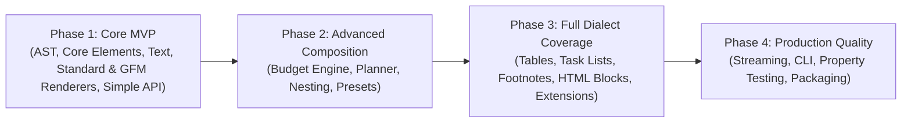

# `dummy-md` — Implementation Work Plan & Roadmap

This document outlines the phased development plan for implementing the `dummy-md` library according to the specifications in [`ARCHITECTURE.md`](file:///e:/work/other/dummy-md/ARCHITECTURE.md).

---

## Roadmap Overview

| Phase | Milestone | Primary Objective | Key Deliverables |
| :--- | :--- | :--- | :--- |
| **Phase 1** | Core MVP | Functional generator for basic documents | AST, Content Engine, Core Generators, Simple API, Determinism |
| **Phase 2** | Advanced Composition | Accurate length budgeting and structural control | Budget engine, Planner, Constraints, Presets, Nesting |
| **Phase 3** | Full Coverage | Extended Markdown element catalog and dialect support | Tables, Task lists, Footnotes, Math, Mermaid, Standard vs GFM |
| **Phase 4** | Production Hardening | CLI, streaming scalability, and property validation | Streaming iterator, CLI tool, Hypothesis tests, Packaging |

---

## Phase 1: Core MVP

### Goals
Deliver a functional, tested Python package that can generate valid, deterministic Markdown documents across standard syntax using a simple API.

### Scope & Tasks
1. **Repository & Foundation Setup**
   - [ ] Establish package layout under `src/dummy_md/`.
   - [ ] Define exceptions hierarchy (`DummyMdError`, `BudgetError`, `DialectError`, `ConfigurationError`).
   - [ ] Configure linting and type checking (Ruff, Mypy in strict mode).

2. **AST Infrastructure (`dummy_md.core.nodes`)**
   - [ ] Base `MarkdownNode`, `BlockNode`, and `InlineNode` types.
   - [ ] Core nodes: `Document`, `Heading` (ATX & Setext), `Paragraph`, `Text`, `Emphasis` (asterisk & underscore), `CodeSpan`, `FencedCodeBlock`, `ListBlock` (unordered & ordered), `ListItem`, `ThematicBreak`.
   - [ ] Node visitor and traversal utilities.

3. **Dummy Content Engine (`dummy_md.text`)**
   - [ ] `DummyContentEngine` protocol and base class.
   - [ ] `PseudowordsGenerator`: Pronounceable syllables and sentence structure.
   - [ ] `LoremGenerator`: Classic Latin placeholder text.
   - [ ] Context helpers: `heading_phrase()`, `sentence()`, `paragraph()`, `identifier()`.

4. **Core Element Generators (`dummy_md.elements`)**
   - [ ] `HeadingGenerator` (ATX levels 1–6, Setext levels 1–2).
   - [ ] `ParagraphGenerator` (inline formatting injection: bold, italic, code spans).
   - [ ] `ListGenerator` (unordered `-`, `*`, `+` and ordered `.`, `)` lists, tight vs loose spacing).
   - [ ] `CodeBlockGenerator` (syntax highlighting tags, backtick & tilde fences).
   - [ ] `ThematicBreakGenerator` (`***`, `---`, `___`).

5. **GFM & Standard Renderers (`dummy_md.renderers`)**
   - [ ] Renderer base protocol and escaping logic (`markdown_escape` for all 12 ASCII punctuation characters).
   - [ ] Serializer for core AST nodes into valid text with normalized blank lines and indentation.

6. **Simple Public API (`dummy_md.api`)**
   - [ ] `dummy_md.generate(length=..., unit=..., dialect="gfm", seed=...)`.
   - [ ] Seeded `random.Random` isolation for 100% reproducibility.

### Acceptance Criteria
- Running `dummy_md.generate(length=1000, seed=42)` returns valid Markdown.
- Output parses cleanly with standard Markdown parsers without structural errors.
- Calling `generate()` with the same seed produces byte-identical strings.
- 100% type annotation coverage passes `mypy --strict`.

---

## Phase 2: Advanced Composition & Budgeting

### Goals
Implement the constraint-first document planner, length budgeting engine, complex nesting rules, and reference link structures.

### Scope & Tasks
1. **Length & Budget Engine (`dummy_md.core.budget`)**
   - [ ] Measurement drivers for `chars`, `words`, `lines`, and `blocks`.
   - [ ] Approximate mode with configurable tolerance (default `±5%`).
   - [ ] Exact mode with feasibility checks and `BudgetError`.
   - [ ] Elastic node post-processing (expanding/contracting filler text).

2. **Document Planner (`dummy_md.core.planner`)**
   - [ ] Constraint solver: guarantee elements with `min_count > 0` are scheduled.
   - [ ] Weighted element selection for remaining budget capacity.
   - [ ] Hierarchy tracking for headings (prevent orphaned H3/H4 tags).
   - [ ] Nesting depth limiter (`max_nesting_depth`).

3. **Advanced AST Nodes & Nesting**
   - [ ] `Blockquote` generator and nested blockquote support (`>>`).
   - [ ] Indented code blocks (4 spaces/tabs) preserving internal blank lines.
   - [ ] Nested lists (ordered inside unordered and vice versa, custom start numbers).
   - [ ] Tight vs. loose list rendering logic.
   - [ ] Link reference definitions (`[label]: destination 'title'`) and link styles:
     - Inline links `[text](url "title")` and angle bracket `<url>`.
     - Full reference links `[text][label]`.
     - Collapsed reference links `[label][]`.
     - Shortcut reference links `[label]`.
   - [ ] Autolinks (URI `<http://...>` and Email `<user@domain>`).
   - [ ] Images (inline and reference forms).
   - [ ] Line breaks (hard break with trailing spaces or backslash; soft break).
   - [ ] Backslash escapes and character references (`&amp;`, `&#38;`, `&#x26;`).

4. **Advanced API & Configuration (`dummy_md.config`)**
   - [ ] `DocumentSpec`, `ElementRule`, `LengthSpec` dataclasses.
   - [ ] `Generator` class with `generate()`, `to_ast()`, and `write(path)` methods.

5. **Built-in Presets (`dummy_md.presets`)**
   - [ ] `default`: Balanced mix of standard elements.
   - [ ] `readme`: Project overview structure (title, badges, description, code snippets, lists).
   - [ ] `minimal`: Lightweight heading and paragraph sequences.

### Acceptance Criteria
- Documents generated in approximate mode fall within specified tolerance.
- Specifying mandatory element counts (`min_count=3`) guarantees at least 3 occurrences in output.
- Heading progression maintains logical semantic hierarchy.
- Link references match their definitions 1:1 without dangling labels.
- Presets produce recognizable, structurally sensible document formats.

---

## Phase 3: Full Dialect Coverage & Extensions

### Goals
Complete the full Markdown feature catalog, support dialect distinction (Standard vs. GFM vs. Extended), and implement the plugin registry.

### Scope & Tasks
1. **HTML Blocks & Raw HTML (`dummy_md.elements.html`)**
   - [ ] All 7 standard HTML block types (scripts/styles, comments `<!-- -->`, instructions `<?...?>`, declarations `<!...>`, CDATA, standard block tags `
`/`
`, complete open/close tags).
   - [ ] Raw inline HTML tags (``, `<kbd>`, ` `).
   - [ ] Disclosure element support (`
` and `
`).

2. **Tables Generator & GFM Support (`dummy_md.elements.tables`)**
   - [ ] Table AST node: headers, alignment (`left`, `center`, `right`), rows, cells.
   - [ ] GFM pipe table serialization with cell padding and pipe escaping (`\|`).
   - [ ] Table options: `min_rows`, `max_rows`, `min_columns`, `max_columns`, `alignment`.

3. **Task Lists & Strikethrough**
   - [ ] Task list items (`- [ ]`, `- [x]`) with configurable completion ratios.
   - [ ] Strikethrough inline formatting (`~~text~~`).
   - [ ] Extended autolinks (bare `https://...` and `www....`).

4. **References & Footnotes (`dummy_md.elements.references`, `dummy_md.extensions.footnotes`)**
   - [ ] Footnote markers (`[^1]`) and corresponding definition blocks at document tail.
   - [ ] Extended reference link generator with collision-free ID hashing.

5. **Extended Elements (`dummy_md.extensions`)**
   - [ ] Math blocks and inline math (`$...$`, `$$...$$`).
   - [ ] Mermaid diagram blocks (`graph TD`, `sequenceDiagram`).
   - [ ] Admonitions / Callouts (`> [!NOTE]`, `> [!WARNING]`).
   - [ ] Frontmatter blocks (YAML `---` and TOML `+++`).

6. **Dialect Matrix & Validator**
   - [ ] Standard dialect renderer (disables tables and task lists, enforcing standard rules).
   - [ ] Dialect capability validator (warns or converts unsupported nodes).
   - [ ] Dynamic Element and Renderer Registry (`ElementRegistry`).

### Acceptance Criteria
- All standard and extended element families from the architectural specification are supported.
- GFM tables render with clean alignment markers and valid pipe delimiters.
- Unsupported elements in Standard dialect mode fall back gracefully or report explicit dialect errors.
- Footnote links match their definitions 1:1 without dangling references.

---

## Phase 4: Production Quality, Streaming, CLI & Ecosystem

### Goals
Prepare `dummy-md` for high-performance production usage, large-scale benchmarks, command-line execution, and PyPI distribution.

### Scope & Tasks
1. **Streaming & Large File Scalability**
   - [ ] Implement `Generator.iter_chunks()` yielding incremental sections.
   - [ ] Byte-accurate size targeting (`--size 100MB`) written directly to disk.
   - [ ] Constant memory profile verified under heap profiling for documents > 100MB.

2. **Command Line Interface (`dummy_md.cli`)**
   - [ ] CLI commands using Python standard `argparse`:
     - `dummy-md generate [options]`
     - `dummy-md elements`
     - `dummy-md presets`
     - `dummy-md validate <file.md>`
   - [ ] Clean stderr reporting, shell exit codes, and pipe redirection (`dummy-md generate | head`).

3. **Comprehensive Testing Suite**
   - [ ] Property-based testing with `Hypothesis`:
     - Random seeds and configurations never throw unhandled exceptions.
     - Generated length conforms to tolerances.
   - [ ] Parser verification suite using standard compliant parsers (`markdown-it-py`):
     - Verify AST fidelity between generated text and parser output tokens.
   - [ ] Determinism regression tests across Python versions.

4. **Plugin Packaging & Documentation**
   - [ ] `dummy_md.elements` entry points discovery for external pip packages.
   - [ ] Complete API documentation, code examples, and performance guidelines.
   - [ ] GitHub Actions CI workflows for linting, testing, and multi-OS matrix builds.

### Acceptance Criteria
- `dummy-md generate --size 50MB --output test.md` completes in acceptable time with < 50MB RAM usage.
- All CLI commands work seamlessly from terminal.
- 95%+ test coverage across unit, property, and integration tests.
- Clean package build (`hatch build` / `pip install .`).

---

## Risk Analysis & Mitigation Strategies

| Risk | Impact | Likelihood | Mitigation Strategy |
| :--- | :--- | :--- | :--- |
| **Length calculation runaway** | High | Medium | Isolate elastic filler adjustments to body paragraphs; pre-calculate fixed structural baselines before generating text. |
| **Parser syntax divergences** | Medium | High | Rely on AST construction; test generated text against strict standard and GFM parsers (`markdown-it-py`). |
| **Memory exhaustion on large files** | High | Low | Emit AST sections incrementally through generator iterators rather than holding multi-gigabyte trees in RAM. |
| **Seed divergence across OSes** | Medium | Low | Use isolated `random.Random` instances with standard algorithms; avoid platform-dependent floats in hashing or selection. |
