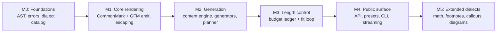

# `dummy-md` — Implementation Work Plan

Companion to [`ARCHITECTURE.md`](ARCHITECTURE.md). The design is fixed; this file tracks what is
built. Feature ids refer to the machine-readable catalog in `src/dummy_md/core/catalog.py`.

Legend: `[x]` implemented and tested · `[ ]` planned · `[-]` deliberately out of scope for now.

---

## Milestone map

| Milestone | Exit criterion |
| :-- | :-- |
| M0 | Catalog validates; AST round-trips through `render`/`to_ast` equality |
| M1 | Every P0 node renders; `markdown-it-py` parses output into expected token types |
| M2 | `generate(length=...)` produces deterministic, structurally valid documents |
| M3 | Exact `chars`/`words` achieved or `BudgetError` raised with a floor |
| M4 | CLI generates, lists, validates; chunks concatenate to `generate()` |
| M5 | Extended features gated by dialect, disabled elsewhere with `DialectError` |

---

## M0 — Foundations

- [ ] `dummy_md.exceptions`: `DummyMdError`, `ConfigurationError`, `DialectError`, `BudgetError`,
      `RenderError`.
- [ ] `dummy_md.core.nodes`: immutable block/inline dataclasses, `Document`, visitors.
- [ ] `dummy_md.core.features`: `FeatureSpec`, glob matching, capability resolution.
- [ ] `dummy_md.core.catalog`: full research inventory as data, P0/P1 marked `implemented`.
- [ ] `dummy_md.core.dialects`: `commonmark`, `gfm`, `extended`, `stress` capability sets.
- [ ] `dummy_md.core.registry`: generator/payload/dialect/feature registration.

## M1 — Core rendering

- [ ] `dummy_md.renderers.base`: mode-aware escaping, fence and code-span delimiter selection,
      block separation rules, capability guard.
- [ ] `dummy_md.renderers.commonmark`: blocks, inlines, references, HTML, entities.
- [ ] `dummy_md.renderers.gfm`: pipe tables, task lists, strikethrough, extended autolinks.
- [ ] Round-trip tests for every P0 node.

## M2 — Generation

- [ ] `dummy_md.text`: `lorem`, `pseudowords`, `tokens`, `alphanumeric`, `numeric` providers and
      the `DummyContentEngine` facade (`heading_phrase`, `sentence`, `paragraph`, `table_cell`,
      `identifier`, `url`, `email`).
- [ ] `dummy_md.elements`: headings, paragraphs, thematic breaks, lists, tables, code blocks,
      quotes, links, images, HTML blocks.
- [ ] `dummy_md.core.context`: RNG, depth, heading tracker, reference registry, budget ledger.
- [ ] `dummy_md.core.planner`: constraint-first schedule, heading skeleton, variety bias.
- [ ] `dummy_md.core.engine`: assemble `Document`, close references, enforce invariants.

## M3 — Length control

- [ ] Unit measurement (`chars`, `words`, `lines`, `blocks`, `bytes`).
- [ ] Approximate mode with tolerance; exact mode with elastic-operation ladder.
- [ ] `BudgetError` carrying requested vs. achievable floor.
- [ ] Determinism tests across subprocesses with distinct `PYTHONHASHSEED`.

## M4 — Public surface

- [ ] `dummy_md.config`: `DocumentSpec`, `ElementRule`, `LengthSpec`, validated.
- [ ] `dummy_md.api`: `generate`, `iter_chunks`, `write`, `available_*`, `validate`.
- [ ] `dummy_md.presets`: `default`, `minimal`, `readme`, `tables`, `stress`.
- [ ] `dummy_md.cli`: `generate`, `elements`, `dialects`, `presets`, `validate`.

## M5 — Extended features

- [ ] Attributes on headings/code fences (`extended`).
- [ ] Footnotes: reference + definition closure.
- [ ] Math: inline/display delimiters, LaTeX payload families.
- [ ] Callouts: GitHub alerts and Obsidian callout kinds.
- [ ] Diagrams: Mermaid family fences.
- [ ] Front matter: YAML, TOML, JSON.
- [ ] Stress fixtures: escapes, Unicode scripts, CRLF, adjacent delimiters.

---

## Out of scope (tracked as catalog entries only)

- `[-]` MDX/JSX emission requires a JS-aware renderer; catalogued, not implemented.
- `[-]` Grid tables with row/column spans: the pipe-table node cannot express them; needs a
  dedicated node before it can be honest.
- `[-]` Platform syntax that only one closed-source editor accepts (Obsidian properties,
  GitLab-only macros) stays catalogued until a parser can verify it.
- `[-]` Executable chunks (Quarto, MyST) emit content only; execution is never attempted.

---

## Risks

| Risk | Impact | Mitigation |
| :-- | :-- | :-- |
| Length fit loop oscillates | High | Monotonic operation ladder; bounded iterations; `BudgetError` with diagnostics |
| Escaping diverges by context | High | Single mode-aware escape function, table-driven per mode, golden tests |
| Dialect claims outrun reality | High | `implemented` flag + capability guard + round-trip test per emitted feature |
| Streaming splits a structure | Medium | Sections cut at top-level block boundaries only |
| Seed drift across versions | Medium | No `hash()`, no float-from-RNG in ordering decisions, pinned algorithms |